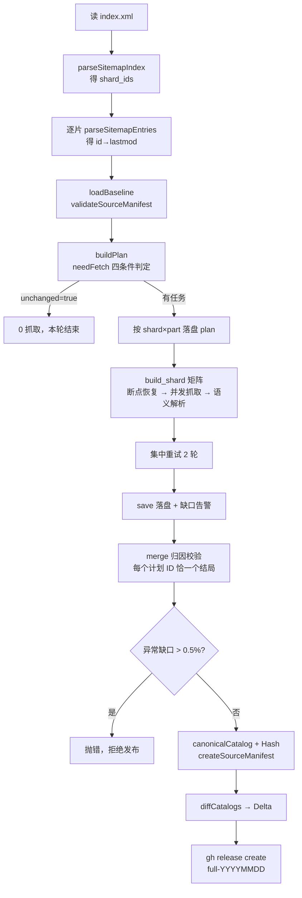

>请分析该项目的整体业务流程与函数调用流程，梳理主要模块之间的调用关系和执行顺序，并为每个函数添加注释，说明其作用、所在文件及在流程中的职责，输出时按业务模块或调用链路分组组织，确保覆盖项目中的全部函数。

# 总结
明白。我先给全部函数补上注释，再把分析整理成文档。先给 `lib/catalog_util.js` 的全部纯函数补上注释。
`catalog_util.js` 的 20 个函数注释已完成。接下来是 `lib/http.mjs` 的容错层。
`plan_run.mjs` 完成。接着给 `build_shard.mjs` 抓取层补注释。
`build_shard.mjs` 完成。现在补 `merge_catalog.mjs` 与 e2e 测试脚本。
代码注释已全部添加并通过语法校验。现在产出结构化文档。

两件事都做完了：给代码补注 + 产文档。

## 一、注释：51 个可调用单元全覆盖

纯新增 408 行、**零逻辑改动**（`git diff --stat` 只有 `+`，无 `-`）：

| 文件                                 | 覆盖单元                                                                                              | 新增行  |
| ---------------------------------- | ------------------------------------------------------------------------------------------------- | ---- |
| `lib/catalog_util.js`              | 20 个领域函数                                                                                          | +161 |
| `lib/http.mjs`                     | `sleep`/`backoff`/`createBreaker`(+`gate`/`record`/`onSuccess`/`onFailure`/`tripped`)/`fetchText` | +47  |
| `scripts/plan_run.mjs`             | 6 个（`arg`/`fetchText`/`loadSitemaps`/`loadBaseline`/`buildPlan`/`main`）                           | +62  |
| `scripts/build_shard.mjs`          | 6 具名 + `save`/`worker` 两个闭包                                                                       | +65  |
| `scripts/merge_catalog.mjs`        | 4 个                                                                                               | +38  |
| `scripts/test_incremental_e2e.mjs` | 3 具名 + 2 个 Mock 请求处理器                                                                             | +35  |

每个块统一四行：**作用 / 入参 / 返回 / 流程职责**，并标出所在文件。`buildPlan` 还补了四步内联标记（跨片去重 → 建桶 → 三态判定 → 汇总）。

**验证**：`node --check` 六个文件全过；用 `--sitemap-dir` 造了 2 分片 3 条数据离线跑通 `plan_run.mjs`，正确产出 `plan.json` + 8 个分桶文件（`fetch=3`）。

## 二、文档：`docs/ARCHITECTURE.md`（545 行）

10 章，按你要求的「模块 → 调用链」分组：

1. 四条设计约束（先记住再看代码，否则会误判很多写法）
2. 四层架构 + 模块职责表（含「是否联网」标记）
3. 5 类数据契约（card / plan / 分片产物 / manifest / delta）逐字段带注释
4. 5 阶段业务流程 + Mermaid 流程图 + 各阶段分支
5. **函数全量说明**：5.1~5.7 分组表格 + 每组的调用关系图 + `parseCard` 失败分类表 + `main` 归因决策树
6. 整体调用链总览（从 GHA 到下游 web 的 5 段竖排树）
7. 依赖矩阵 + **三处隐式契约**（无类型校验，改一处必须同步另一处）
8. 8 个关键调用点（改动风险最高处）
9. 7 项已知不一致
10. 51 单元速查表

## 三、顺手挖出的问题（文档 §9 有详细方案）

- **`unchanged` 永久失效**（最要紧）：`buildPlan` 构造当前清单时恒写 `status='ok'`，但 `sourceHash` 把 status 算进摘要，而基线里有 `gone/invalid` → 两边永不相等 → 每个周期照常拉起 112 个 job 空转。
- **e2e 测试跑不起来**：路径全写死 `/mnt/data/code/namehere/...`，还跨仓库 `import` 了 `hongguo-web/lib/catalog_db.js`。
- **README 已过期**：`build_shard` 的 `--parts/--baseline/--full` 和 `merge` 的 `--from-tag` 都不存在了。
- `normalizeSitemapEntries` + `sitemapHash` 是死代码（`buildPlan` 误用了 `normalizeManifestEntries`）；`merge` 有一处不可达的 `throw`；`canonicalCatalog` 在大库上被重复排序 3 次以上。

要不要我接着把 §9.1、§9.2、§9.3 这三个实际影响的修掉？都是小改动。


# hongguo-data 架构与调用链说明

> 本文档覆盖仓库内**全部可调用单元**（43 个具名函数 + 4 个熔断器方法 + 2 个 main 内闭包 + 2 个 Mock 请求处理器，共 51 个），  
> 按「模块 → 调用链」分组组织，每个函数标注作用、所在文件、入参、返回值与在流程中的职责。  
> 源码中已有对应的 JSDoc 注释，二者一一对应，可直接对照阅读。

---

## 1. 系统定位与设计主旨

**做什么**：把红果短剧（hongguoduanju.com）的 Sitemap 全量分片（当前 28 片、约 57.5 万条唯一 ID）抓取为结构化元数据索引，  
并以「全量包 + 增量补丁 + 源状态清单」三件套持续发布到 GitHub Release，供下游 Web 服务增量同步。

**四条不可妥协的设计约束**（读代码前先记住，否则会误判很多“奇怪”的写法）：

| 约束                   | 实现手段                               | 反面做法                    |
| -------------------- | ---------------------------------- | ----------------------- |
| 分片数量**不许写死**         | 每次读 `index.xml` 动态发现，解析不出即抛错       | `for (i=1; i<=26; i++)` |
| 增量必须**精确**，不能多抓也不能漏抓 | `needFetch` 四条件判定 + FNV-1a 稳定分桶    | 按时间窗口粗抓                 |
| 数据缺口是**业务结果**，不是工程故障 | 全局 0.5% 阈值把关，单分片失败不阻断发布            | 任一 job 失败即整体作废          |
| 宁可本轮不跑，也不**写坏账**     | fail-fast + 严格归因 + Hash 自校验 + 原子降级 | 静默兜底、局部容错放行             |

---

## 2. 分层架构与模块职责

```
┌──────────────────────────────────────────────────────────────┐
│ 编排层   .github/workflows/build-all-shards.yml               │
│          plan job → shard matrix job → merge job → Release    │
└───────────────┬──────────────────────────────────────────────┘
                │ 调用（node CLI）
┌───────────────▼──────────────────────────────────────────────┐
│ 应用层   scripts/plan_run.mjs   规划器（只读上游，产出计划）    │
│          scripts/build_shard.mjs 抓取器（只抓计划内 ID）        │
│          scripts/merge_catalog.mjs 合并器（纯本地，不联网）     │
│          scripts/test_incremental_e2e.mjs 端到端验收           │
└───────────────┬──────────────────────────────────────────────┘
                │ import
┌───────────────▼──────────────────────────────────────────────┐
│ 领域层   lib/catalog_util.js   数据契约、归一化、Hash、Delta   │
│ 基建层   lib/http.mjs          分类重试、退避、熔断、时限       │
└──────────────────────────────────────────────────────────────┘
```

| 模块    | 文件                                 | 职责                                                     | 输入                                    | 输出                                        | 是否联网 |
| ----- | ---------------------------------- | ------------------------------------------------------ | ------------------------------------- | ----------------------------------------- | ---- |
| 数据契约层 | `lib/catalog_util.js`              | 纯函数：*解析 XML*、卡片整形、排序去重、SHA-256、manifest 校验、Delta 差分/应用 | XML 文本 / card[] / 三元组[]               | Map / card[] / Buffer / hex / delta       | 否    |
| 抓取基建层 | `lib/http.mjs`                     | 唯一联网出口：状态码分类（404/410 终态，其余全重试）、指数退避、全局熔断、deadline      | url + opts                            | 四态联合对象                                    | 是    |
| 规划器   | `scripts/plan_run.mjs`             | 发现分片 → 比对基线 → 输出精确抓取计划                                 | 总索引 + 分片 XML + 基线 manifest            | `plan.json` + `plan_<s>_<p>.json`         | 是    |
| 抓取器   | `scripts/build_shard.mjs`          | 只抓计划内 ID，断点续跑，如实归因，不做发布决策                              | `plan_<s>_<p>.json`                   | `shard_<s>.part<p>.json` + `_report.json` | 是    |
| 合并器   | `scripts/merge_catalog.mjs`        | 基线复用 + 逐条归因 + 全局缺口把关 + Delta/Hash                      | `plan.json` + `shards/*` + 基线 catalog | 5 类产物                                     | 否    |
| 验收器   | `scripts/test_incremental_e2e.mjs` | Mock 上游 + Mock Release，真实 spawn 三个脚本做回归                | 自造 1000 部基线                           | 断言结果                                      | 本地回环 |

---

## 3. 数据契约（模块间唯一耦合面）

### 3.1 card（catalog 元素）

```jsonc
{
  "id": "7600000000000000001", // 雪花 ID，字符串（超出 2^53）
  "title": "剧名",              // 去首尾空白，取首行
  "cover": "https://p3-novel.byteimg.com/...", // 域名已归一到 p3
  "intro": "前 50 字",          // 空白折叠后截断
  "tags": ["都市"],             // ≤ 6 个，去空
  "eps": 80,                    // 总集数，必须 > 0
  "ch": "",                     // 预留字段，目前恒为空串
  "new_at": "2026-10-02"        // 优先 first_visible_time，回退雪花 ID 高位
}
```

### 3.2 plan（plan_run → build_shard / merge）

```jsonc
{
  "schema": 2,
  "mode": "incremental",        // 或 "full"（审计）
  "unchanged": false,           // true 时下游全部跳过
  "parts": 4,
  "from_tag": "full-20261001",  // 基线血统
  "from_catalog_hash": "…",
  "from_source_hash": "…",
  "target_source_hash_if_all_ok": "…",
  "summary": { "sitemap_unique_total": 575000, "total_fetch": 50, "total_reuse": 574950 },
  "sitemap_entries": [["7600000000000000001", "2026-10-02T12:00:00+08:00"]], // 发布范围的唯一真相
  "shard_ids": [1, 2, 4, 7],
  "shards": [
    { "shard": 1, "total": 20000, "fetch_count": 3, "reuse_count": 19997,
      "parts": [{ "part": 0, "fetch_count": 1, "items": [{ "id": "…", "lastmod": "…" }] }] }
  ]
}
```

### 3.3 分片产物（build_shard → merge）

- `shard_<s>.part<p>.json`：`card[]`（已抓到的）
- `shard_<s>.part<p>_report.json`：`{ shard, part, assigned, found, gone, invalid, unaccounted, deadlineHit, goneIds[], invalidIds[{id,reason}], elapsedSec, updatedAt }`

### 3.4 source manifest（merge → 下一轮 plan）

```jsonc
{ "schema": 2, "type": "source-manifest", "tag": "full-20261002",
  "catalog_hash": "…", "source_hash": "…",
  "entries": [["7600000000000000001", "2026-10-02T12:00:00+08:00", "ok"]] } // status ∈ ok|gone|invalid
```

### 3.5 delta（merge → 下游 Web）

```jsonc
{ "schema": 2, "type": "catalog-delta",
  "from_tag": "…", "to_tag": "…", "from_catalog_hash": "…", "to_catalog_hash": "…",
  "from_count": 1000, "to_count": 1020,
  "added": [/* card */], "modified": [/* card */], "deleted": ["id"] }
```

---

## 4. 主业务流程与执行顺序



### 阶段 0：编排触发

- cron `0 19 * * *`（UTC，即北京 03:00）或人工 `workflow_dispatch`。
- `MODE=full` **或** 当天是周日（`DOW=0`）→ 走「全量审计」：强制全抓修偏，但**仍拉基线**以产出 Delta。
- 拉基线：
	- `gh release download <latest>` 取 `source_manifest.json.gz` + `catalog.json.gz`。  
	- 拉取失败 → `has_baseline=false` → 退化为无基线全量。

### 阶段 1：规划（plan job）

1. `loadSitemaps()`：读总索引 → `parseSitemapIndex` → 逐片 `parseSitemapEntries`。
2. `loadBaseline()`：gunzip → `validateSourceManifest`（schema/type/hash 三重校验）。
3. `buildPlan()` 四步：跨片去重 → 建桶 → 三态判定 → 汇总 hash 与统计。
4. 落盘 `plan.json` 与 `plan_<shard>_<part>.json`，并把 `mode/unchanged/shards/from_tag/has_baseline` 写入 `$GITHUB_OUTPUT`。

### 阶段 2：抓取（shard job × 28 分片 × 4 part = 112 个 job）

1. `main()` 建熔断器（窗口 20、失败率 0.5、冷却 15s→120s），设 40 分钟自设 deadline。
2. **断点恢复**：读已有 `outFile`/`reportFile`，仅保留属于当前计划 ID 的记录。
3. `worker()` × 并发 6：共享游标抢占 → `fetchText`（tries 3 / 20s）→ 三分支处理 → 每 200 条或 30s `save()`。  
   |  |  |  |  
   | --- | --- | --- |
4. **集中重试 ×2 轮**：只捞 `net:*` 与 `bad_payload|loader_fail|no_seriesDetail`，并发降至 2。
5. 收尾 `save()`；缺口 > 8% 且 > 5 条 → 告警；若一条都没抓到且非时限原因 → `exit(1)` 留红灯给人工。

### 阶段 3：合并（merge job，`!cancelled() && plan.success && unchanged!='true'`）

1. **归因**：遍历 `plan.shards→parts→items`，把每条抓取结果登记到 ok/gone/invalid，并校验「未计划/重复/冲突」即抛错。
2. **兜底**：缺产物（job 崩溃/上传失败）→ `net:missing_artifact`；仍无归因 → `net:unaccounted`。
3. **组表**：以 `plan.sitemap_entries` 为唯一真相，逐条决定 采用新卡 / 删除 / 保留旧卡 / 复用基线。
4. **质量闸**：`gapCount / sitemapTotal > 0.005` → 抛错拒绝发布。
5. **固化**：`canonicalCatalog` → `catalogBytes`/`catalogHash` → `createSourceManifest` → `diffCatalogs` → 5 类产物。

### 阶段 4：发布

- tag = `full-YYYYMMDD`；同名先删后建；`--latest`。
- 附件：`catalog.json.gz`、`summary.json`、`source_manifest.json.gz`，有 Delta 时追加 `catalog.delta.json.gz`、`delta.summary.json`。
- 手动实验（`limit != 0`）或 `publish=false` 时不发布。

### 阶段 5：下游消费（跨仓库 hongguo-web）

`build_sqlite_catalog.mjs`：先下 Delta → 校验 hash → `applyDeltaToCatalog` → 原子落库；  
Delta 损坏 → 平滑回退全量（诚实标记 `full-fallback`）；全部失败 → **保留旧库不变**（零坏账）。

---

## 5. 函数全量说明（按模块分组）

### 5.1 `lib/catalog_util.js` — 数据契约层（20 个函数）

> 全部为纯函数（除 `sha256Hex` 依赖 crypto），无 IO、无状态，可独立单测。

| #  | 函数                                                | 作用                                   | 入参                                                                | 返回                         | 流程职责                                    |
| -- | ------------------------------------------------- | ------------------------------------ | ----------------------------------------------------------------- | -------------------------- | --------------------------------------- |
| 1  | `sha256Hex(value)`                                | 求 SHA-256 十六进制摘要                     | `value: string\|Buffer`                                           | `string` 64 位 hex          | 三处 Hash 与 `delta_sha256` 的底座            |
| 2  | `normalizeCover(url)`                             | 封面域名归一到 `p3-novel`，还原 `\u002F`       | `url: string`                                                     | `string`                   | 保证同剧任何入口得到同一字符串，避免假 modified            |
| 3  | `idToDate(id)`                                    | 雪花 ID 高 32 位 → 秒级时间戳 → 日期            | `id: string\|number`                                              | `'YYYY-MM-DD'` 或 `''`      | `safeDate` 的兜底路径                        |
| 4  | `safeDate(ts, id)`                                | 时间戳安全转日期（上界 2100 年）                  | `ts, id`                                                          | `'YYYY-MM-DD'`             | 决定 `new_at` 与默认排序                       |
| 5  | `parseSitemapEntries(xmlText)`                    | 分片 XML → `Map<id, lastmod>`，同 ID 取最新 | `xmlText: string`                                                 | `Map<string,string>`       | 规划器的数据源；缺 lastmod 即抛错                   |
| 6  | `parseSitemapIndex(xmlText)`                      | 总索引 → 升序分片号数组                        | `xmlText: string`                                                 | `number[]`                 | **规模发现入口**，杜绝写死分片数                      |
| 7  | `partForId(id, parts)`                            | FNV-1a 稳定分桶                          | `id, parts`                                                       | `0..parts-1`               | plan/build/GHA matrix 三方的隐式契约           |
| 8  | `normalizeCard(raw)`                              | 原始条目 → 合规 card，非法返 null              | `raw: object`                                                     | `object\|null`             | 抓取侧断点恢复、合并侧产物校验的统一整形                    |
| 9  | `compareCards(a, b)`                              | `new_at` 降序、同日 `id` 升序               | `a, b`                                                            | `number`                   | `canonicalCatalog` 排序器，保证字节确定性          |
| 10 | `canonicalCatalog(list)`                          | 整形 + 拒非法 + 拒重复 + 排序                  | `list: Array`                                                     | `object[]`                 | **规范化总闸**，所有 Hash/Delta 的前置条件           |
| 11 | `catalogBytes(list)`                              | 序列化为 UTF-8 Buffer                    | `list`                                                            | `Buffer`                   | 落盘与 Hash 共用同一份字节                        |
| 12 | `catalogHash(list)`                               | catalog 内容指纹                         | `list`                                                            | `hex`                      | `summary.catalog_hash`、delta 的 from/to  |
| 13 | `normalizeManifestEntries(entries)`               | 校验三元组 `[id,lastmod,status]` 并排序      | `entries`                                                         | `[[string,string,string]]` | manifest 合法形态的唯一定义                      |
| 14 | `sourceHash(entries)`                             | 源状态指纹（**含 status**）                  | `entries`                                                         | `hex`                      | `unchanged` 判定依据（也是其失效根因）               |
| 15 | `normalizeSitemapEntries(entries)`                | 校验二元组 `[id,lastmod]`                 | `entries`                                                         | `[[string,string]]`        | `plan.sitemap_entries` 的合法形态；**当前未被调用** |
| 16 | `sitemapHash(entries)`                            | 二元组指纹                                | `entries`                                                         | `hex`                      | 设计上用于上游快照比对；**当前未被调用**                  |
| 17 | `validateSourceManifest(manifest)`                | schema/type/hash 三重校验                | `manifest`                                                        | 附规范化 entries 的新对象          | 决定走增量还是无基线全量                            |
| 18 | `createSourceManifest({tag,catalogHash,entries})` | 生成下一轮基线清单                            | `{tag, catalogHash, entries}`                                     | `manifest`                 | merge 的终态固化，兼「基线」与「对账凭据」                |
| 19 | `diffCatalogs(base, target, metadata)`            | 逐条比对产 Delta                          | `base[], target[], {fromTag,toTag,fromCatalogHash,toCatalogHash}` | `catalog-delta`            | 下游「1~3MB 替代 80MB」的核心                    |
| 20 | `applyDeltaToCatalog(base, delta)`                | 应用 Delta 并严格互斥校验                     | `base[], delta`                                                   | `card[]`                   | 消费端契约，**本仓库无调用者**（供 web 用）              |

**调用关系**

```
catalogBytes  → canonicalCatalog → (normalizeCard, compareCards)
catalogHash   → catalogBytes → canonicalCatalog
sourceHash    → normalizeManifestEntries → sha256Hex
sitemapHash   → normalizeSitemapEntries → sha256Hex
validateSourceManifest → normalizeManifestEntries + sourceHash
createSourceManifest   → normalizeManifestEntries + sourceHash
diffCatalogs  → canonicalCatalog ×2
applyDeltaToCatalog → canonicalCatalog ×2 + normalizeCard
safeDate      → idToDate
```

---

### 5.2 `lib/http.mjs` — 抓取基建层（1 私 + 3 公 + 4 方法）

| #   | 单元                        | 作用                        | 入参                                                                        | 返回                                                                                 | 职责                 |
| --- | ------------------------- | ------------------------- | ------------------------------------------------------------------------- | ---------------------------------------------------------------------------------- | ------------------ |
| 21  | `sleep(ms)`（私有）           | 可 await 定时                | `ms`                                                                      | `Promise<void>`                                                                    | 退避与冷却的时间原语         |
| 22  | `backoff(ms, jitter)`（私有） | 指数退避 + 抖动，钳制 [800ms, 90s] | `ms, jitter`                                                              | `number`                                                                           | 局部退避（与全局熔断互补）      |
| 23  | `createBreaker(opts)`     | 构造全局熔断器                   | `{window=20, minSamples, ratio=0.5, baseMs=15000, maxMs=120000, log}`     | `{gate, record, onSuccess, onFailure, tripped}`                                    | 被限流时全体 worker 一起冷却 |
| 23a | `.gate()`                 | 请求前闸门，冷却期则等待              | 无                                                                         | `Promise<void>`                                                                    | 把熔断落到每个请求前         |
| 23b | `.record(ok)`             | 登记成败、窗口统计、升级冷却等级          | `ok: boolean`                                                             | `void`                                                                             | 熔断状态唯一写入口          |
| 23c | `.onSuccess()`            | 登记成功（连续 window 次则降级）      | 无                                                                         | `void`                                                                             | 2xx 与 404/410 时调用  |
| 23d | `.onFailure()`            | 登记失败                      | 无                                                                         | `void`                                                                             | 所有可重试失败分支调用        |
| 23e | `.tripped`（getter）        | 是否处于冷却期                   | 无                                                                         | `boolean`                                                                          | 仅供观测               |
| 24  | `fetchText(url, opts)`    | 带分类/退避/熔断/时限的文本抓取         | `url, {tries, timeoutMs, headers, breaker, expired, jitter, backoffBase}` | 四态：`{ok,text,status}` | `{ok:false,gone}` | `{ok:false,error}` | `{deadline:true}` | **全仓唯一联网出口**       |


**分类规则（反转白名单）**

```
404 / 410   → gone（终态，不重试）
2xx         → ok（交给调用方做语义校验）
其余一切     → 可重试：403 挑战 / 429 / 444 WAF 断连 / 5xx / 超时 / DNS 抖动 / 连接重置
```

|                                                                            |                                            |
| -------------------------------------------------------------------------- | ------------------------------------------ |
| **调用关系**：`fetchText` → `breaker.gate()` → `fetch()` → (`breaker.onSuccess` | `breaker.onFailure` → `sleep` → `backoff`) |

---

### 5.3 `scripts/plan_run.mjs` — 规划器（6 个函数）

| #  | 函数                                                     | 作用                 | 入参                 | 返回                       | 职责                                     |
| -- | ------------------------------------------------------ | ------------------ | ------------------ | ------------------------ | -------------------------------------- |
| 25 | `arg(flag, fallback)`                                  | 读 `--flag value`   | `flag, fallback`   | 值或默认                     | 参数解析                                   |
| 26 | `fetchText(url, tries=4)`                              | 包装 http 层，失败即抛     | `url, tries`       | `string`                 | **规划阶段 fail-fast 闸门**                  |
| 27 | `loadSitemaps(sitemapDir, site)`                       | 索引 → 分片全量解析        | `sitemapDir, site` | `[{shard, entries:Map}]` | 管线入口，分片数完全由上游决定                        |
| 28 | `loadBaseline(path)`                                   | 读 + 校验上一轮 manifest | `path`             | `manifest\|null`         | 决定增量/全量；唯一读取历史 gone/invalid 的入口        |
| 29 | `buildPlan({sitemaps, baselineManifest, parts, mode})` | **核心纯函数**：合成抓取计划   | 见 §3.2             | `plan` 对象                | 既是抓取清单，也是发布范围真相                        |
| 30 | `main()`                                               | 串起取数→读基线→算计划→落盘    | 无                  | `Promise<void>`          | GHA plan job 入口，产出 crawl-plan artifact |

**`buildPlan` 内部四步**

```
① 跨片去重：同 ID 取 lastmod 最新者，分片归属跟随最新 lastmod
② 建桶：每片预建 parts 个桶 {part, fetch_count, items[]}（即 build_shard 的任务文件格式）
③ 三态判定：needFetch = isFull || 无基线 || lastmod≠基线 || 基线 status≠'ok'
              → true 计入对应 (shard, part)；false 只计 reuse_count
④ 汇总：normalizeManifestEntries → sourceHash → unchanged；摊平成 shard_ids / shards / sitemap_entries
```

**调用链**

```
main
├─ arg ×6
├─ loadSitemaps
│   ├─ fetchText (本地包装) → lib/http.fetchText
│   ├─ parseSitemapIndex
│   └─ parseSitemapEntries ×N
├─ loadBaseline
│   ├─ validateSourceManifest
│   │   ├─ normalizeManifestEntries
│   │   └─ sourceHash → normalizeManifestEntries → sha256Hex
├─ buildPlan
│   ├─ partForId ×N
│   ├─ normalizeManifestEntries
│   └─ sourceHash
└─ fs.writeFileSync ×(1 + 分片数×4)
```

---

### 5.4 `scripts/build_shard.mjs` — 抓取器（6 具名 + 2 闭包）

| #  | 单元                     | 作用                        | 入参               | 返回                    | 职责                          |
| -- | ---------------------- | ------------------------- | ---------------- | --------------------- | --------------------------- |
| 31 | `arg(flag, fallback)`  | 参数解析                      | `flag, fallback` | 值                     | 解析 9 个 CLI 参数               |
| 32 | `num(v, def)`          | 字符串安全转数字                  | `v, def`         | `number`              | 数值参数统一钳制                    |
| 33 | `expired()`（模块箭头）      | 是否到自设时限                   | 无                | `boolean`             | 注入 fetchText 与两个循环，到点先落盘再收工 |
| 34 | `fetchText(url, opts)` | 注入 UA/Referer/熔断/deadline | `url, opts`      | 四态结果                  | 本文件联网唯一出口                   |
| 35 | `parseCard(text, id)`  | 响应 → card 或失败原因           | `text, id`       | `{card}` | `{reason}` | **语义判定唯一入口**，区分可重试与判死       |
| 36 | `save()`（main 内闭包）     | 卡片 + 归因报告落盘               | 无                | `void`                | 断点续跑与产物交付的统一出口              |
| 37 | `worker()`（main 内闭包）   | 单协程，共享游标抢任务               | 无                | `Promise<void>`       | 并发模型核心，天然负载均衡               |
| 38 | `main()`               | 读计划→恢复→抓取→重试→落盘→缺口评估      | 无                | `Promise<void>`       | GHA matrix job 入口           |

**`parseCard` 的失败分类（关键设计）**

| reason            | 含义                        | 是否重试  |
| ----------------- | ------------------------- | ----- |
| `bad_payload`     | 响应不是 JSON（WAF 挑战页常见）      | ✅ 可重试 |
| `loader_fail`     | `isSuccess === false`     | ✅ 可重试 |
| `no_seriesDetail` | 200 但无 `seriesDetail`（空壳） | ✅ 可重试 |
| `no_title`        | 确实没有剧名                    | ❌ 判死  |
| `no_episodes`     | 集数为 0，非有效剧集               | ❌ 判死  |

> 设计理由：WAF 常以 **200 返回挑战页**。若一律当「数据不存在」永久判死，该条目将再也抓不回来。

**调用链**

```
main
├─ num / arg ×N
├─ createBreaker → {gate, onFailure, onSuccess}
├─ 断点恢复：JSON.parse(outFile) → normalizeCard ×N
├─ Promise.all(worker × concurrency)
│   └─ worker
│       ├─ expired()
│       ├─ fetchText → lib/http.fetchText → breaker.gate → fetch → parseCard
│       │   └─ parseCard → safeDate → idToDate / normalizeCover
│       └─ save()（每 200 条或 30s）
├─ 重试轮 ×2：匿名协程 ×2 → fetchText(tries:4, 20s) → parseCard
└─ save() → 缺口阈值判定 → 必要时 process.exit(1)
```

---

### 5.5 `scripts/merge_catalog.mjs` — 合并器（4 个函数）

| #  | 函数                            | 作用                   | 入参                 | 返回              | 职责                                    |
| -- | ----------------------------- | -------------------- | ------------------ | --------------- | ------------------------------------- |
| 39 | `arg(flag, fallback)`         | 参数解析                 | `flag, fallback`   | 值               | 解析 5 个 CLI 参数                         |
| 40 | `writeGzipFile(path, buffer)` | Level-9 流式压缩落盘       | `filePath, buffer` | `Promise<void>` | 三份产物的统一压缩出口                           |
| 41 | `loadBaseline(path)`          | 读 + 规范化上一版全量 catalog | `path`             | `card[]\|null`  | 复用源 + Delta 对比基准（与 plan_run 同名函数语义不同） |
| 42 | `main()`                      | 归因 → 组表 → 质量闸 → 固化   | 无                  | `Promise<void>` | merge job 入口                          |

**`main` 的归因决策树（每个计划 ID 必须且只能命中一条）**

```
遍历 plan.sitemap_entries(以 sitemap 为唯一真相)
├─ crawledCatalog 有   → ok，采用新卡（fetchedCount++）
├─ gone 有             → gone，不进 catalog（最终体现为 delta.deleted）
├─ invalid 有
│   ├─ 基线有卡 → 保留旧卡（retainedOnFailure++），status=invalid 下轮强制重抓
│   └─ 基线无卡 → gapCount++
├─ 非 full 且基线有卡   → 复用基线（reusedCount++）
└─ 其余                → throw（防御性死分支：上文兜底已保证不可达）
```

**两处「缺口降级」**（数据缺口 ≠ 合并错误）：

|   |   |   |
| - | - | - |

- `part.fetch_count > 0 && (!hasResult || !hasReport)` → 该 part 内未归因项标 `net:missing_artifact`
- 全计划遍历后仍无归因 → `net:unaccounted`  
  两者都不 throw，交给 `gapCount / sitemapTotal > 0.5%` 统一拒绝发布。

**调用链**

```
main
├─ loadBaseline（gunzipSync → canonicalCatalog）
├─ 归因循环 ×(分片×part)
│   ├─ normalizeCard(raw)
│   └─ fs.existsSync / readFileSync / JSON.parse
├─ canonicalCatalog → catalogBytes → catalogHash ×2
├─ createSourceManifest → normalizeManifestEntries → sourceHash → sha256Hex
├─ writeGzipFile ×2~3
├─ diffCatalogs → canonicalCatalog ×2
└─ fs.writeFileSync(summary.json / delta.summary.json / 明文 json) → sha256Hex(deltaGz)
```

---

### 5.6 `scripts/test_incremental_e2e.mjs` — 端到端验收（3 具名 + 2 处理器）

| #  | 单元                         | 作用                                                     | 入参                     | 返回                | 职责                     |
| -- | -------------------------- | ------------------------------------------------------ | ---------------------- | ----------------- | ---------------------- |
| 43 | `run(cmd, args, opts)`     | spawn 子进程并汇聚输出                                         | `cmd, args, opts`      | `Promise<string>` | 跑真实 CLI 而非 import 内部函数 |
| 44 | `ok(cond, title, details)` | 断言，失败即 exit(1)                                         | `cond, title, details` | `void`            | 断言统一出口                 |
| 45 | `main()`                   | 造基线 → Mock 上游 → 真跑三脚本 → 审计模式 → Mock Release → web 侧三场景 | 无                      | `Promise<void>`   | 唯一回归防线                 |
| 46 | 上游处理器（匿名）                  | 模拟 index.xml / indexN.xml / /player/:id，其余 404         | `req, res`             | —                 | 验证 gone 语义与零冗余抓取       |
| 47 | Release 处理器（匿名）            | 提供 dist 产物下载，可注入 `corrupt_delta` / `all_fail`          | `req, res`             | —                 | 验证下游降级与零坏账             |

**覆盖的 7 项断言**

1. 增量规划精确 50 条任务（30 新增 + 20 修改；10 删除不进任务）
2. 分片列表来自总索引（故意用 `[1,2,4,7,11,16,22,28,30]` 非连续集合，证伪写死 26）
3. 零冗余抓取（Mock 侧统计 player 请求恰为 50）
4. 合并 1020 条、Delta `+30 / ~20 / -10`
5. full 审计模式仍产出 Delta（`summary.has_delta === true`）
6. 下游增量落库 `sync_mode=delta`、Delta 损坏回退 `full-fallback`
7. 全失败时 SQLite 条数与 hash 均不变（零坏账）

---

### 5.7 `.github/workflows/build-all-shards.yml` — 编排（非 JS）

| 步骤        | 关键动作                                                                        | 与代码的耦合点                                                |
| --------- | --------------------------------------------------------------------------- | ------------------------------------------------------ |
| `base`    | `gh release view/download` 拉基线，判定 `is_audit`                                | 只认 `source_manifest.json.gz` + `catalog.json.gz` 两个文件名 |
| `plan`    | `node scripts/plan_run.mjs --parts 4`                                       | **`--parts 4` 必须与 matrix 的 `part: [0,1,2,3]` 一致**      |
| `shard`   | `matrix.shard = fromJSON(plan.outputs.shards)` × `part [0,1,2,3]`           | 分片数完全由 plan 输出驱动                                       |
| `merge`   | `node scripts/merge_catalog.mjs --plan-file plan/plan.json --in-dir shards` | 依赖 `shard_<s>.part<p>.json` 扁平化后的命名                    |
| `publish` | `gh release create full-YYYYMMDD --latest`                                  | 附件清单与 merge 产物名一一对应                                    |

---

## 6. 整体调用链总览（自上而下）

```
[GHA] build-all-shards.yml
  │
  ├─(1) plan job ────────────────────────────────────────────────
  │    plan_run.main()
  │      ├─ loadSitemaps ── fetchText → http.fetchText → fetch()
  │      │                ├─ parseSitemapIndex
  │      │                └─ parseSitemapEntries
  │      ├─ loadBaseline ── validateSourceManifest ── normalizeManifestEntries + sourceHash → sha256Hex
  │      └─ buildPlan ──── partForId / normalizeManifestEntries / sourceHash
  │
  ├─(2) shard job ×(28×4) ───────────────────────────────────────
  │    build_shard.main()
  │      ├─ createBreaker
  │      ├─ worker ×6 ── fetchText → http.fetchText ── breaker.gate/onSuccess/onFailure
  │      │              └─ parseCard ── safeDate ── idToDate / normalizeCover
  │      ├─ 重试协程 ×2
  │      └─ save()
  │
  ├─(3) merge job ───────────────────────────────────────────────
  │    merge_catalog.main()
  │      ├─ loadBaseline ── canonicalCatalog
  │      ├─ 归因 ── normalizeCard
  │      ├─ canonicalCatalog → catalogBytes → catalogHash → sha256Hex
  │      ├─ createSourceManifest
  │      ├─ writeGzipFile → gzip(level 9)
  │      └─ diffCatalogs ── canonicalCatalog ×2
  │
  ├─(4) publish ── gh release create
  │
  └─(5) 下游 hongguo-web（跨仓库）
       build_sqlite_catalog.mjs → applyDeltaToCatalog（失败降级全量）
```

---

## 7. 跨模块依赖矩阵

| 依赖方 ↓ / 被依赖 →   |               catalog_util               |         http        | plan 文件 | 分片产物 | 基线 catalog | manifest |
| --------------- | :--------------------------------------: | :-----------------: | :-----: | :--: | :--------: | :------: |
| plan_run        |             ✔（解析/校验/hash/分桶）             |   ✔（fail-fast 用法）   |    写    |   —  |      —     |     读    |
| build_shard     | ✔（normalizeCard/safeDate/normalizeCover） | ✔（熔断 + deadline 用法） |    读    |   写  |      —     |     —    |
| merge_catalog   |                 ✔（全量 API）                |          —          |    读    |   读  |      读     |     写    |
| test_e2e        |               ✔（造基线/算 hash）              |          —          |    间接   |  间接  |      写     |     写    |
| GHA workflow    |                     —                    |          —          |   产物搬运  | 产物搬运 |    产物搬运    |   产物搬运   |
| hongguo-web（外部） |          ✔（applyDeltaToCatalog）          |          —          |    —    |   —  |      读     |     读    |

**三处隐式契约（无类型、无 schema 校验，改一处必须同步改另一处）**：

1. `partForId(id, 4)` —— plan 写桶 / build 读桶 / workflow 声明 matrix，三方靠同一个哈希函数对齐。
2. 文件名 `plan_<shard>_<part>.json`、`shard_<shard>.part<part>.json(_report.json)` —— 在 plan、build、merge 中各自硬编码。
3. 字段名 `items / id / lastmod / goneIds / invalidIds / fetch_count` —— merge 直接读 JSON，改字段名会静默出错。

---

## 8. 关键调用点（改动风险最高的 8 处）

| 调用点                                  | 位置                              | 为什么关键                       |
| ------------------------------------ | ------------------------------- | --------------------------- |
| `partForId(id, parts)`               | plan_run.buildPlan / GHA matrix | parts 不一致 → 静默漏抓或重复抓，且无任何报错 |
| `fetchText` 的 404/410 判定             | lib/http.mjs                    | 判错即把可恢复内容永久标记为 gone 并删除     |
| `RETRYABLE_SEMANTIC`                 | build_shard.mjs                 | WAF 挑战页若被当终态，内容再也抓不回来       |
| `gapCount / sitemapTotal > 0.005`    | merge_catalog.main              | 全局质量闸，放宽即可能发布残缺索引           |
| `unchanged` 判定                       | plan_run.buildPlan              | 提前终止开关，口径不一致会导致空转（见 §9.1）   |
| `canonicalCatalog`                   | catalog_util                    | 排序/去重规则一变，所有历史 Hash 失效      |
| `diffCatalogs` 的 `JSON.stringify` 比对 | catalog_util                    | 字段净化不彻底会把「等价数据」误判为 modified |
| `matrix.part: [0,1,2,3]`             | workflow                        | 与 `--parts 4` 是硬耦合，改一处漏一处   |

---

## 9. 已知不一致与改进建议

### 9.1 `unchanged` 会永久失效（优先级最高）

- `plan_run` 构造当前清单时**恒写 `status='ok'`**，而基线 manifest 里可能残留 `gone / invalid`；
- `sourceHash` 把 `status` 计入摘要 → 一旦历史上出现过非 ok 条目，两边 hash 永不相等；
- 后果：`unchanged` 恒为 `false`，每个调度周期都会拉起 112 个 job（`fetch_count` 虽小，但 job 空转成本真实存在）。
- 建议：`buildPlan` 构造当前清单时，沿用基线中该 ID 的 `gone/invalid` 状态参与 hash；或改用只含 `[id,lastmod]` 的 `sitemapHash` 做 `unchanged` 判定。

### 9.2 e2e 测试路径硬编码

`test_incremental_e2e.mjs` 中所有脚本路径写死 `/mnt/data/code/namehere/...`，并 `import('/mnt/data/code/namehere/hongguo-web/lib/catalog_db.js')`。  
**在本机与 CI 均无法直接运行**。建议改为：

```js
const ROOT = path.resolve(import.meta.dirname, '..');
const WEB_ROOT = process.env.HG_WEB_ROOT || path.resolve(ROOT, '../hongguo-web');
```

### 9.3 README 已过期

- `build_shard.mjs` 的 `--parts / --baseline / --full` 参数**已不存在**（职责已上移到 planner）；
- `merge_catalog.mjs` 的 `--from-tag` 参数**已不存在**（改由 plan 里的 `from_tag` 携带）。

### 9.4 `sitemap_entries` 构造语义混用

`buildPlan` 用 `normalizeManifestEntries`（要求 `status` 合法）产出二元组，而非专用的 `normalizeSitemapEntries`。  
当前因恒写 `'ok'` 而未报错，属于**潜在误抛点**；`normalizeSitemapEntries` 与 `sitemapHash` 因此成为死代码。

### 9.5 merge 的防御性死分支

`else throw 'Sitemap ID 未获得可用归因'` 永远不可达（上文兜底已把无归因项标成 invalid）。保留无害，但易让人误以为「这里会因缺数据抛错」。

### 9.6 性能与内存

- `catalogHash` / `catalogBytes` 内部各跑一次 `canonicalCatalog`（全量排序 + 去重），merge 阶段对 ~57.5 万条重复排序 **3 次以上**；
- 明文 `JSON.stringify` 会产生 ~80MB 字符串再 gzip，峰值内存偏高；
- 建议：合并期只 `canonicalCatalog` 一次，后续直接复用已排序数组与已算字节。

### 9.7 断点恢复的边界

恢复仅按 `outFile` / `reportFile` 存在性判断。若 `outFile` 丢失而 `reportFile` 存在，已抓卡片会丢；  
此时 merge 侧会把该 part 标 `net:missing_artifact` 重抓，属于**可自愈**，无需修改。

---

## 10. 附：函数速查表（51 个单元）

|     # | 名称                                                                   | 文件                               | 层级          |
| ----: | -------------------------------------------------------------------- | -------------------------------- | ----------- |
|  1-20 | `sha256Hex` … `applyDeltaToCatalog`                                  | lib/catalog_util.js              | 领域层         |
|    21 | `sleep`                                                              | lib/http.mjs                     | 基建层（私有）     |
|    22 | `backoff`                                                            | lib/http.mjs                     | 基建层（私有）     |
|    23 | `createBreaker`                                                      | lib/http.mjs                     | 基建层         |
| 23a-e | `gate / record / onSuccess / onFailure / tripped`                    | lib/http.mjs                     | 熔断器方法       |
|    24 | `fetchText`                                                          | lib/http.mjs                     | 基建层（唯一联网出口） |
| 25-30 | `arg / fetchText / loadSitemaps / loadBaseline / buildPlan / main`   | scripts/plan_run.mjs             | 应用层         |
| 31-38 | `arg / num / expired / fetchText / parseCard / save / worker / main` | scripts/build_shard.mjs          | 应用层         |
| 39-42 | `arg / writeGzipFile / loadBaseline / main`                          | scripts/merge_catalog.mjs        | 应用层         |
| 43-47 | `run / ok / main / 上游处理器 / Release 处理器`                              | scripts/test_incremental_e2e.mjs | 验收层         |
